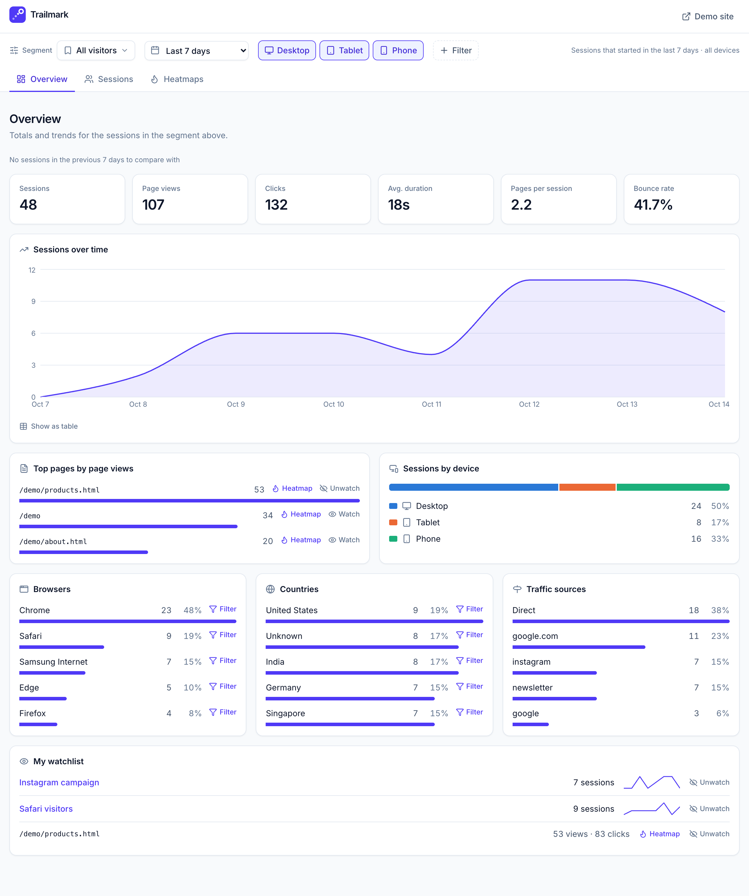
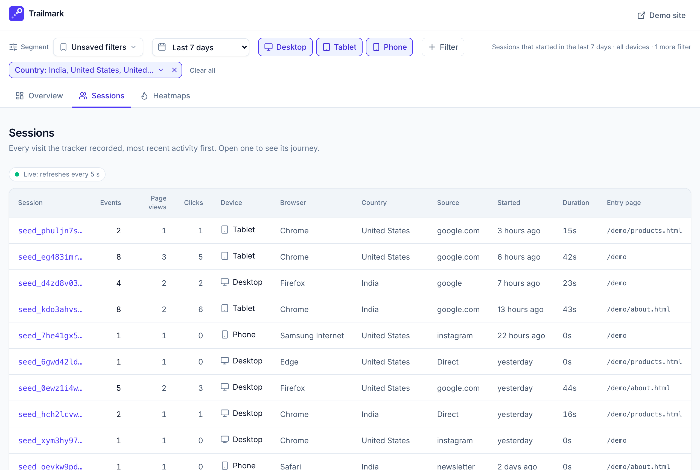
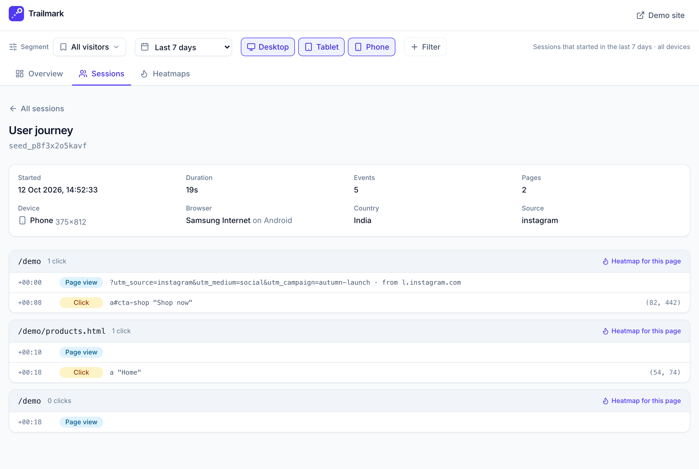
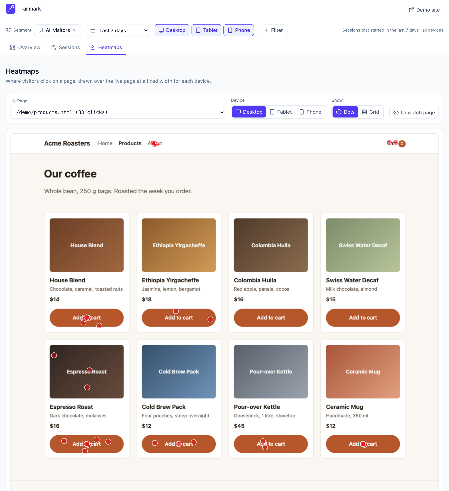

# Trailmark: user analytics

Trailmark is a small full-stack analytics app, built as the take-home for
CausalFunnel's Full Stack Engineer role. A dependency-free script (`tracker.js`) records
`page_view` and `click` events on any web page and sends them to a Node/Express
API, which validates them and stores them in MongoDB. A Next.js dashboard lists
the sessions, replays each one as an ordered user journey, and draws a
per-page click heatmap over the page itself. A three-page demo shop (Acme
Roasters, fictional) and a seed script supply data to look at.

**Live:** [Dashboard](https://useranalytics-dashboard.vercel.app) ·
[Demo shop](https://useranalytics-api.onrender.com/demo/) (browse it, then
watch your session appear on the dashboard) ·
[API health](https://useranalytics-api.onrender.com/health).
The API is on a free tier that sleeps when idle, so the first request can
take up to a minute.

## Contents

- [Screenshots](#screenshots)
- [How it works](#how-it-works)
- [Tech stack](#tech-stack)
- [Run it locally](#run-it-locally)
- [Deployment](#deployment)
- [Embedding the tracker](#embedding-the-tracker)
- [Seed script](#seed-script)
- [API reference](#api-reference)
- [Data model and indexes](#data-model-and-indexes)
- [Assumptions and trade-offs](#assumptions-and-trade-offs)
- [What I'd do next](#what-id-do-next)
- [Project layout](#project-layout)

## Screenshots

The dashboard is one page: a filter bar on top, then three tabs that it
scopes. The filter bar is the segment: a date range, devices, and any of
browser, OS, country, referrer, UTM tags, entry, exit or visited page, session
duration, pages and clicks. Each filter shows as a chip that opens its editor.
A set of filters can be saved as a named segment, one segment can be the
default (applied when the dashboard opens without filters), and segments and
pages can be watched: **My watchlist** on the Overview follows them with live
numbers. Saved segments and the watchlist stay in the viewer's browser.

**Overview.** Headline numbers with the change from the previous period,
sessions per day, top pages, the split by device, browser, country and
traffic source, and My watchlist.



**Sessions.** Every session in the segment, with event counts, most recent
activity first. The list refreshes every 5 seconds.



**User journey.** One session's events in order, grouped by page visit, opened
inside the Sessions tab. The header shows the traffic source (`utm_source`,
else the referrer).



**Heatmaps.** Clicks drawn over the live page at a fixed width per device, as
dots or a 40 px grid.



## How it works

```text
   any web page                          Express API  (server/)                MongoDB
  +---------------------+  POST /api/events  +---------------------------+     +------------+
  | <script tracker.js> | -----------------> | validate each event,      | --> |   events   |
  | page_view, click    |  text/plain beacon | normalize the URL, derive |     | collection |
  +---------------------+                    | the device, store         |     | (3 indexes)|
                                             |                           | <-- |            |
  +---------------------+  GET, every 5 s    | GET /api/sessions         |     +------------+
  | Next.js dashboard   | -----------------> | GET /api/sessions/:id/... |
  | Sessions, Journey,  | <----------------- | GET /api/pages            |
  | Heatmap             |  JSON              | GET /api/heatmap          |
  +---------------------+                    |                           |
            |                                | static: /tracker.js,      |
            +--- sandboxed iframe ---------> | /demo/  (the demo shop)   |
                 ?cf_preview=1               +---------------------------+
```

1. **Tracking.** `tracker.js` loads with `defer`. It reads or creates the
   session in `localStorage` and records a `page_view`. Clicks are caught on
   `document` in the capture phase, so page code that stops propagation can't
   hide them.
2. **Sending.** Events are queued and sent in batches: at 10 events, 5 seconds
   after the first one, or when the page is hidden or unloaded. Batches go out
   with `navigator.sendBeacon` as `text/plain`, which needs no CORS preflight
   and still sends while the page navigates away. If the beacon is refused,
   `fetch` with `keepalive` sends the batch instead.
3. **Ingestion.** The API validates each event on its own and keeps the valid
   ones. It normalizes `page_url` (the browser's URL is kept as `raw_url`),
   derives `device` from the viewport width, adds the server's `received_at`
   and the request's `User-Agent`, and inserts the batch. Then it recomputes
   each session in the batch from its events into the `sessions` collection
   (browser, OS, country, source, campaign, entry and exit page). It answers
   `202` with accepted and rejected counts.
4. **Reading.** The dashboard fetches from the browser with SWR and re-fetches
   every 5 seconds, so new visits appear without a reload. The filter bar
   picks a segment, a set of sessions: lists and totals read the `sessions`
   collection, and heatmaps and page counts read the events of the matching
   sessions.
5. **Heatmap.** The page itself is shown in a sandboxed iframe (no scripts, no
   navigation) at the device's reference width, with `?cf_preview=1` so the
   tracker on it stays off. The clicks are drawn on top.

### How the heatmap places clicks

Visitors click at whatever window size they have, but each device's heatmap is
drawn at one reference width: 1280 px for desktop, 768 for tablet, 375 for
mobile. Each click is mapped onto that layout
([`dashboard/src/lib/heatmap.ts`](dashboard/src/lib/heatmap.ts)):

| | Desktop | Tablet and mobile |
|---|---|---|
| **x** | Keeps its distance from the page centre: `x + (1280 − doc_w) / 2`. Desktop sites are usually a centred column. | Keeps its share of the width: `x / doc_w × 768` (or 375). Phone and tablet layouts are usually fluid. |
| **y** | As recorded. A fixed-width column doesn't reflow. | Keeps its share of the page height: `y × refHeight / doc_h`. Text reflows with width, which moves everything below it. |

- `refHeight` is the page's height at the reference width: the most common
  `doc_h` among clicks recorded in a window exactly that wide (the taller one
  on a tie).
- `doc_h` is the document's `scrollHeight`. On a page shorter than the window,
  that is the window's height, not the page's. So only clicks on pages taller
  than their window (`doc_h > viewport_h`) set `refHeight` or get scaled.
- Clicks that land off the canvas are counted and reported, not drawn.

Two versions came before this one. The first scaled `y` by width, which put
clicks on the About page's bottom button 273 px too high at 1440 px. The second kept `y`
as recorded on every device, which missed by 23 px on a 390 px phone in the
end-to-end check. The current rules put every checked click on its element.

## Tech stack

| Layer | Choice | Why |
|---|---|---|
| Tracker | Vanilla JavaScript (ES5 syntax), no dependencies, no build step | Works on any page as a single `<script>` tag: 7 KB, about 3 KB gzipped |
| API | Node.js 22, Express 5, ESM JavaScript, helmet, cors, express-rate-limit | Same language as the tracker and the dashboard, and no build step to deploy |
| Database | MongoDB 7 with Mongoose 9 | Schema, validation and indexes are declared in one place |
| Dashboard | Next.js 16 (App Router), React 19, TypeScript, Tailwind CSS 4, SWR, Recharts, lucide-react | Polling with SWR makes the dashboard live without websockets; Recharts draws the charts; every icon has a text label |
| Tests | Vitest, supertest, mongodb-memory-server, happy-dom | Real MongoDB queries without a running database. The tracker runs in a simulated browser |
| Hosting | Render (API, tracker, demo pages), Vercel (dashboard), MongoDB Atlas M0 | All free tiers |

The spec allows Node.js or Flask. This project uses Node only.

## Run it locally

**Prerequisites:** Node.js 22.12 or newer, and Docker with Compose (Docker
Desktop, OrbStack, or similar) for the local MongoDB. Any MongoDB 7 instance
works if you point `MONGODB_URI` at it instead.

```bash
git clone https://github.com/prakhar23381/UserAnalyticsApplication.git
cd UserAnalyticsApplication

docker compose up -d                                  # MongoDB 7 on localhost:27017
cp server/.env.example server/.env                    # API settings
cp dashboard/.env.local.example dashboard/.env.local  # dashboard -> API URL
npm install                                           # all workspaces, from the repo root
npm run seed                                          # optional: 40 fake sessions
npm run dev                                           # API on :4000 and dashboard on :3000
```

Then open:

| | URL |
|---|---|
| Demo shop (tracked) | http://localhost:4000/demo/ |
| Dashboard | http://localhost:3000 |
| API health check | http://localhost:4000/health |

Browse the demo shop and click around. The session shows up on the dashboard
within about 10 seconds: up to 5 s for the tracker to send, plus up to 5 s
for the dashboard to poll.

`npm install` also downloads a MongoDB binary (about 150 MB) for the
in-memory test database, into `node_modules/.cache`.

### Configuration

| File | Variable | Meaning |
|---|---|---|
| `server/.env` | `MONGODB_URI` | Required. The API exits at startup without it. |
| | `PORT` | API port. Default `4000`. |
| | `DASHBOARD_ORIGIN` | Comma-separated origins allowed to call the read endpoints. The same list goes into the CSP `frame-ancestors`, which lets the dashboard show the demo pages in an iframe. Default `http://localhost:3000`. |
| | `NODE_ENV` | `production` hides the messages of 500 errors and turns on `upgrade-insecure-requests`. |
| | `CLIENT_IP_HEADER` | Production only. A header the hosting edge overwrites with the client's address, used to tell clients apart for the rate limit (`true-client-ip` on Render). Leave it unset anywhere else: without such an edge, clients could send their own. |
| | `COUNTRY_HEADER` | Production only. A header the hosting edge sets to the visitor's two-letter country (`cf-ipcountry` behind Cloudflare). It is stored as `country`; IP addresses never are. Unset, sessions have no country. |
| `dashboard/.env.local` | `NEXT_PUBLIC_API_URL` | Required. Base URL of the API. It is inlined at build time, so a build without it fails, and changing it needs a rebuild. |

Only the `*.example` files are committed.

### Tests and checks

```bash
npm test                         # server: API tests (supertest + in-memory MongoDB) and tracker tests (happy-dom)
npm test -- --project tracker    # one Vitest project only
npm -w dashboard test            # dashboard: unit tests for the heatmap math, formatting and journey grouping
npm -w dashboard run typecheck   # next typegen && tsc --noEmit
npm -w dashboard run lint
npm -w dashboard run build
```

The server tests need no running MongoDB: each run starts one in-memory
`mongod`, with a separate database per test file. The tracker tests load the
real `public/tracker.js` through a `<script src>` tag in happy-dom. They check,
among other things, that every event it sends passes the API's validator.

### UI lab

With `npm run dev` running, open http://localhost:3000/lab to work on the
dashboard before deploying it:

- **Screens:** the real dashboard, with your local data, in frames at desktop,
  tablet and phone width, in light and dark, side by side. Pick the tab, add a
  query (such as `session=…`) and zoom.
- **Components:** each building block in its states (loading, empty, error,
  filled) with sample data.
- **Tokens:** the colours, brand scale and type from `globals.css`.

The lab is for local work only: production builds return 404 for `/lab`. Any
page also takes `?theme=light` or `?theme=dark` to force a theme.

## Deployment

The API (with the tracker and the demo shop) runs on Render, the dashboard on
Vercel, and the data on MongoDB Atlas, all on free tiers. The deployment
config is in the repo: [`render.yaml`](render.yaml) and
[`dashboard/vercel.json`](dashboard/vercel.json).

1. **MongoDB Atlas.** Create an M0 cluster in the same region as the API
   (Singapore here) and a database user. Allow network access from anywhere
   (`0.0.0.0/0`), because Render's free tier has no fixed outbound
   addresses. Copy the connection string and put the database name in its
   path: `…mongodb.net/causalfunnel?…`.
2. **Render.** Choose New → Blueprint and pick the repository. Render reads
   `render.yaml` and asks for two values:
   - `MONGODB_URI`: the Atlas connection string
   - `DASHBOARD_ORIGIN`: the dashboard's origin, such as `https://<project>.vercel.app`

   Render may ask for a card before it creates a Blueprint. A plain New → Web
   Service on the free instance type doesn't need one: enter the same build
   command, start command, health check path and environment variables as
   `render.yaml`, with the root directory left empty. That is how the live
   API was created.
3. **Vercel.** Import the repository and set:
   - Root Directory: `dashboard`
   - Node.js Version: 22.x
   - Environment variable `NEXT_PUBLIC_API_URL`: the Render URL, such as `https://<service>.onrender.com`
4. **Seed** (optional), from your machine. The script refuses a remote
   database without `--allow-remote`:

   ```bash
   MONGODB_URI='<atlas connection string>' npm run seed -- --base-url https://<service>.onrender.com --allow-remote
   ```

Why the config looks the way it does:

- Render builds from the repo root, because the only lockfile is there, and
  installs just the server's runtime dependencies
  (`npm ci --omit=dev -w server`, about 16 MB). It pins Node 22, which is
  what the tests run on; an open range like `>=22.12` would get the newest
  release.
- Vercel installs only the dashboard's dependencies
  (`npm ci -w dashboard --include=dev`). The default install would also
  pull in the server and the test tools, including a 141 MB MongoDB binary.
- `DASHBOARD_ORIGIN` must match the dashboard's origin exactly. It is both
  the CORS allow-list for the read endpoints and the CSP `frame-ancestors`
  that lets the heatmap frame the demo pages. Vercel preview deployments have
  other origins, so they can't read the API.
- `NEXT_PUBLIC_API_URL` is built into the dashboard, so changing it needs a
  redeploy.
- A push to `main` redeploys both.

## Embedding the tracker

```html
<script src="http://localhost:4000/tracker.js" defer></script>
```

The script sends events to its own origin's `/api/events`. To serve the file
from somewhere else, give it the API's endpoint:

```html
<script src="https://cdn.example.com/tracker.js"
        data-endpoint="https://api.example.com/api/events" defer></script>
```

**What each event carries:**

| Field | Events | Notes |
|---|---|---|
| `session_id` | all | From `localStorage` key `cf_session`. A new one starts after 30 minutes without events. The tabs of one browser share it. If storage is blocked, it is kept in memory for the page's lifetime. |
| `type` | all | `page_view` or `click` |
| `page_url` | all | `location.href`. The server stores a normalized copy and keeps the original as `raw_url`. |
| `timestamp` | all | Client clock, ISO 8601 UTC |
| `referrer` | all | `document.referrer`, when there is one |
| `viewport_w`, `viewport_h` | all | Window size in CSS px |
| `doc_w`, `doc_h` | all | Document `scrollWidth` and `scrollHeight` |
| `x`, `y` | click | `pageX` and `pageY`: document coordinates in CSS px, rounded. A keyboard or scripted click has no pointer position, so it is placed at the element's centre. |
| `target` | click | The nearest link, button or form field (else the clicked element): `tag`, `id`, `classes`, and `text` for links, buttons and labels only, cut to 80 characters |

**Privacy.** Form field values are never read. Element text is collected only
for links, buttons and labels. No cookies are set, and the API doesn't store
IP addresses. The demo's newsletter form uses POST, so a typed email can never
end up in a URL, and so never in a tracked `page_url`.

**Behaviour.**

- The tracker never throws into the host page: every entry point is wrapped.
- It does nothing inside an iframe or when the URL has `?cf_preview=1`. This
  keeps the dashboard's heatmap preview from recording visits.
- A page restored from the back/forward cache counts as a new `page_view`.
- Loading the script twice is harmless.

## Seed script

The seed script adds fake but realistic visits to the demo shop, so the
dashboard has something to show:

```bash
npm run seed                      # add 40 sessions to MONGODB_URI (from server/.env)
npm run seed -- --reset           # first delete earlier seeded sessions, then add
npm run seed -- --sessions 80     # 1 to 1000 sessions
```

- **Sessions.** They are spread over the past 7 days, with a device mix of
  50% desktop, 35% mobile and 15% tablet. They vary their entry page, their
  traffic source (UTM source, medium and campaign, and referrers), their
  browser and OS, and their country. Visitors browse, add to cart
  and sign up for the newsletter. About 40% leave after one page.
- **Clicks.** Every click lands on a real element. The positions come from
  the demo pages, measured at the heatmap's reference widths (1280, 768,
  375). If the demo markup or CSS changes, the positions need measuring again.
- **Validation.** Every event goes through the API's validator before it is
  stored.
- **Safe re-seeding.** Seeded session ids start with `seed_`, and `--reset`
  deletes only those, events and session summaries. Real visits survive a
  re-seed.
- **Remote databases.** The script refuses to write to a database that isn't
  on localhost unless you pass `--allow-remote`. `--base-url` sets the host
  in the seeded page URLs (default `http://localhost:4000`).

The `sessions` collection is built from the events, so it can always be
recreated. The API does that by itself on its first start with an empty
`sessions` collection. After a change to how sessions are summarized, rebuild
it by hand (the same `--allow-remote` rule applies):

```bash
npm -w server run sessions:rebuild
```

## API reference

Base URL locally: `http://localhost:4000`. JSON field names are snake_case,
the same as in the database.

- **CORS.** `POST /api/events` accepts any origin, without credentials. The
  read endpoints allow only the origins in `DASHBOARD_ORIGIN`.
- **Errors.** Every error body is `{ "error": "message" }`.
- **Query parameters.** A parameter repeated in the query (`?page=1&page=2`)
  gets a `400`.
- **Segment filters.** The read endpoints (except a single journey) take the
  dashboard's filter bar as optional parameters, combined with AND. A segment
  is a set of sessions: `GET /api/sessions` and `GET /api/overview` describe
  those sessions, and `GET /api/pages` and `GET /api/heatmap` count only their
  events. Without filters, every endpoint covers everything.

| Parameter | Value |
|---|---|
| `from`, `to` | ISO 8601 instants: sessions that **started** in `[from, to)` |
| `devices` | Comma-separated: `desktop`, `tablet`, `mobile` (a session's device is its first event's) |
| `browsers` | Comma-separated: `Chrome`, `Safari`, `Firefox`, `Edge`, `Samsung Internet`, `Opera`, `Other` |
| `os` | Comma-separated: `Windows`, `macOS`, `iOS`, `Android`, `ChromeOS`, `Linux`, `Other` |
| `countries` | Comma-separated two-letter codes; `unknown` matches sessions without one |
| `referrers` | Comma-separated hosts of referring sites, without `www.`; `direct` matches sessions without one |
| `utm_source`, `utm_medium`, `utm_campaign` | One exact value each, from the landing page's URL (campaign names may contain commas) |
| `entry_page`, `exit_page`, `visited_page` | One page URL each, normalized like `page_url` |
| `min_duration`, `max_duration` | Seconds, inclusive |
| `min_pages`, `max_pages` | Page views, inclusive |
| `min_clicks`, `max_clicks` | Clicks, inclusive |
- **Rate limit.** `POST /api/events` allows 120 requests a minute per client.
  Responses carry `RateLimit` and `RateLimit-Policy` headers, and a client over
  the limit gets `429` with a `Retry-After` header. The read endpoints aren't
  limited.

| Method | Path | Purpose |
|---|---|---|
| `POST` | `/api/events` | Receive and store events |
| `GET` | `/api/sessions` | The segment's sessions, with counts and attributes |
| `GET` | `/api/sessions/:id/events` | One session's events, in order |
| `GET` | `/api/pages` | Every tracked page, for the heatmap's page picker |
| `GET` | `/api/heatmap` | Click positions on one page |
| `GET` | `/api/overview` | Headline numbers, sessions per day, top pages, and the split by device, browser, country and source for a segment |
| `GET` | `/api/filters` | The values the filter menus offer, with session counts |

The server also serves `GET /health` (`{ "ok": true }`), `GET /tracker.js` and
the demo shop at `/demo/`.

### `POST /api/events`

The body is `{ "events": [ ... ] }` with 1 to 50 events, or a single event
object (handy with curl). The tracker sends `Content-Type: text/plain`, and
`application/json` works too. Bodies are limited to 64 KB.

```bash
curl -X POST http://localhost:4000/api/events \
  -H 'Content-Type: application/json' \
  -d '{"session_id":"readme-test","type":"click","page_url":"http://localhost:4000/demo/","timestamp":"2026-10-14T09:00:00Z","x":120,"y":340,"viewport_w":1280,"viewport_h":800,"doc_w":1280,"doc_h":920}'
```

```json
{ "accepted": 1, "rejected": 0 }
```

Each event is validated on its own:

| Field | Rule |
|---|---|
| `type` | `page_view` or `click` |
| `session_id` | 1–64 characters of `A-Z a-z 0-9 _ -` |
| `page_url` | An http(s) URL of up to 2048 characters |
| `timestamp` | ISO 8601, no more than 24 hours in the future |
| `viewport_w`, `viewport_h`, `doc_w`, `doc_h` | Numbers from 0 to 100 000 |
| `x`, `y` | Clicks only: numbers from 0 to 100 000 |

Unknown fields are dropped and long strings are truncated.

| Status | When | Body |
|---|---|---|
| `202` | At least one event was valid | `accepted`, `rejected`, and `errors` if any event was rejected |
| `400` | No valid events, or the body isn't valid JSON | `error`, plus the counts and `errors` when events were rejected |
| `413` | More than 50 events, or a body over 64 KB | `error` |
| `429` | More than 120 requests from this client in the last minute | `error` |

`errors` lists the first 10 rejected events, as `[{ "index": 3, "error": "type must be one of: page_view, click" }]`.

### `GET /api/sessions`

| Parameter | Default | Notes |
|---|---|---|
| `page` | `1` | |
| `limit` | `20` | 1 to 100; out-of-range values are clamped |
| Segment filters | | See above |

Sorted by most recent activity. `device`, `browser`, `os`, `country` and
the traffic fields describe the session's first event. `source` is
`utm_source`, else `referrer`, else `Direct`. A missing value is `null`.

```json
{
  "data": [
    {
      "session_id": "1c7f99e5-4872-4765-bbab-22477e7b2fb4",
      "event_count": 21,
      "page_views": 9,
      "clicks": 12,
      "first_seen": "2026-10-13T05:05:40.142Z",
      "last_seen": "2026-10-13T05:06:05.388Z",
      "duration_ms": 25246,
      "entry_page": "http://localhost:4000/demo",
      "exit_page": "http://localhost:4000/demo/about.html",
      "pages_visited": 3,
      "device": "desktop",
      "browser": "Chrome",
      "os": "macOS",
      "country": "IN",
      "referrer": "google.com",
      "utm_source": null,
      "utm_medium": null,
      "utm_campaign": null,
      "source": "google.com"
    }
  ],
  "page": 1,
  "limit": 20,
  "total": 48
}
```

### `GET /api/sessions/:id/events`

All of the session's events, oldest first. Ties are broken by `_id`, so events
from the same millisecond keep their insertion order. An id in the wrong
format gets `400`, and an unknown session gets `404`. `session` is the same
summary as a row of `GET /api/sessions` (shortened here).

```json
{
  "session_id": "seed_jzsqovvli6m0",
  "session": { "session_id": "seed_jzsqovvli6m0", "browser": "Chrome", "os": "Windows", "country": "US", "source": "Direct" },
  "events": [
    {
      "_id": "6acd602016277a5f837f5f6a",
      "session_id": "seed_jzsqovvli6m0",
      "type": "page_view",
      "page_url": "http://localhost:4000/demo",
      "raw_url": "http://localhost:4000/demo/?utm_source=newsletter",
      "timestamp": "2026-10-08T21:23:02.005Z",
      "received_at": "2026-10-08T21:23:05.901Z",
      "viewport_w": 1280,
      "viewport_h": 800,
      "doc_w": 1280,
      "doc_h": 920,
      "device": "desktop",
      "user_agent": "Mozilla/5.0 (Windows NT 10.0; Win64; x64) AppleWebKit/537.36 (KHTML, like Gecko) Chrome/152.0.0.0 Safari/537.36"
    },
    {
      "_id": "6acd602016277a5f837f5f6b",
      "session_id": "seed_jzsqovvli6m0",
      "type": "click",
      "page_url": "http://localhost:4000/demo",
      "raw_url": "http://localhost:4000/demo/?utm_source=newsletter",
      "timestamp": "2026-10-08T21:23:09.450Z",
      "received_at": "2026-10-08T21:23:10.617Z",
      "x": 318,
      "y": 416,
      "target": { "tag": "a", "id": "cta-learn", "classes": "btn btn-secondary", "text": "Learn more" },
      "viewport_w": 1280,
      "viewport_h": 800,
      "doc_w": 1280,
      "doc_h": 920,
      "device": "desktop",
      "user_agent": "Mozilla/5.0 (Windows NT 10.0; Win64; x64) AppleWebKit/537.36 (KHTML, like Gecko) Chrome/152.0.0.0 Safari/537.36"
    }
  ]
}
```

### `GET /api/pages`

Every page the segment's sessions saw, most-clicked first. Takes the segment
filters.

```json
{
  "data": [
    { "page_url": "http://localhost:4000/demo/products.html", "page_views": 58, "clicks": 109, "last_seen": "2026-10-13T05:06:05.746Z" },
    { "page_url": "http://localhost:4000/demo/about.html", "page_views": 24, "clicks": 32, "last_seen": "2026-10-13T05:06:05.045Z" },
    { "page_url": "http://localhost:4000/demo", "page_views": 30, "clicks": 19, "last_seen": "2026-10-13T05:06:05.388Z" }
  ]
}
```

### `GET /api/heatmap`

| Parameter | Default | Notes |
|---|---|---|
| `page` | required | A page URL. It is normalized the same way as stored events, so `/demo/index.html?utm_source=x` finds `/demo`. |
| `device` | `all` | `all`, `desktop`, `tablet` or `mobile`: the layout to draw, by the device of each click |
| Segment filters | | See above. Only the matching sessions' clicks count |

Returns the newest 5000 clicks at most. `total_clicks` is the uncapped count.
Each click carries only the fields the heatmap needs.

```json
{
  "page_url": "http://localhost:4000/demo/products.html",
  "device": "desktop",
  "total_clicks": 40,
  "clicks": [
    { "x": 552, "y": 31, "viewport_w": 1512, "viewport_h": 900, "doc_w": 1512, "doc_h": 1144, "device": "desktop" },
    { "x": 1173, "y": 929, "viewport_w": 1512, "viewport_h": 900, "doc_w": 1512, "doc_h": 1144, "device": "desktop" }
  ]
}
```

### `GET /api/overview`

Takes the segment filters. Without `to`, the range ends now.

| Field | Meaning |
|---|---|
| `totals` | Sessions that started in the range: sessions, page views, clicks, average duration, pages per session, and bounce rate (the share of sessions with at most one page view, 0–1) |
| `previous` | The same numbers for the period of equal length just before `from`; `null` without `from` (all time) |
| `series` | Sessions per UTC day, with days without sessions filled in as 0 |
| `top_pages` | The five pages with the most page views by those sessions |
| `devices` | Sessions per device (a session's device is its first event's) |
| `browsers`, `countries`, `sources` | The five most common values with their sessions; a `null` country means none was recorded |

```json
{
  "range": { "from": "2026-10-08T00:00:00.000Z", "to": "2026-10-15T00:00:00.000Z" },
  "totals": { "sessions": 37, "page_views": 90, "clicks": 132, "avg_duration_ms": 23678, "pages_per_session": 2.43, "bounce_rate": 0.4324 },
  "previous": { "sessions": 11, "page_views": 22, "clicks": 28, "avg_duration_ms": 22687, "pages_per_session": 2, "bounce_rate": 0.3636 },
  "series": [
    { "date": "2026-10-08", "sessions": 7 },
    { "date": "2026-10-09", "sessions": 7 }
  ],
  "top_pages": [
    { "page_url": "http://localhost:4000/demo/products.html", "page_views": 47 },
    { "page_url": "http://localhost:4000/demo", "page_views": 24 }
  ],
  "devices": [
    { "device": "desktop", "sessions": 16 },
    { "device": "mobile", "sessions": 13 },
    { "device": "tablet", "sessions": 8 }
  ],
  "browsers": [{ "value": "Chrome", "sessions": 21 }, { "value": "Safari", "sessions": 16 }],
  "countries": [{ "value": "IN", "sessions": 12 }, { "value": "US", "sessions": 9 }],
  "sources": [{ "value": "Direct", "sessions": 13 }, { "value": "google.com", "sessions": 11 }]
}
```

The series and lists are shortened here; the response has one series entry
per day.

### `GET /api/filters`

The values that the sessions which started in the range actually have, with
how many sessions have each, most common first (at most 100 per list). Takes
`from` and `to` only, so choosing one filter doesn't empty the other menus.

```json
{
  "browsers": [{ "value": "Chrome", "sessions": 29 }, { "value": "Safari", "sessions": 19 }],
  "os": [{ "value": "macOS", "sessions": 17 }, { "value": "iOS", "sessions": 16 }],
  "countries": [{ "value": "IN", "sessions": 14 }, { "value": "unknown", "sessions": 2 }],
  "referrers": [{ "value": "direct", "sessions": 28 }, { "value": "google.com", "sessions": 13 }],
  "utm_source": [{ "value": "newsletter", "sessions": 8 }],
  "utm_medium": [{ "value": "email", "sessions": 8 }],
  "utm_campaign": [{ "value": "october-beans", "sessions": 8 }],
  "entry_pages": [{ "value": "http://localhost:4000/demo", "sessions": 23 }],
  "exit_pages": [{ "value": "http://localhost:4000/demo/products.html", "sessions": 20 }],
  "pages": [{ "value": "http://localhost:4000/demo/products.html", "sessions": 31 }]
}
```

## Data model and indexes

Events are the source of truth: one document per event in `events`
([`server/src/models/Event.js`](server/src/models/Event.js)). The `sessions`
collection summarizes them, one document per session, for the filters.

| Field | Type | Notes |
|---|---|---|
| `session_id` | string | From the tracker |
| `type` | `page_view` \| `click` | |
| `page_url` | string | Normalized: `origin + pathname`, without query, hash, trailing slash or `index.html`. Heatmaps group by it. |
| `raw_url` | string | Exactly what the browser had, including UTM tags |
| `timestamp` | Date | Client clock |
| `received_at` | Date | Server clock |
| `x`, `y`, `target` | number, number, object | Clicks only |
| `viewport_w`, `viewport_h`, `doc_w`, `doc_h` | number | CSS px |
| `device` | `mobile` \| `tablet` \| `desktop` | Derived on the server from `viewport_w`: under 768 is mobile, under 1024 is tablet. Never taken from the client. |
| `referrer` | string | Optional |
| `user_agent` | string | From the request header, not the body |
| `country` | string | Two letters, from `COUNTRY_HEADER` when it is set. Never from the body |

| Index | Used by |
|---|---|
| `{ session_id: 1, timestamp: 1 }` | Rebuilding a session's summary, a session's journey, the events of a segment's sessions (top pages), and the seed script's `--reset` (an anchored `^seed_` prefix match) |
| `{ page_url: 1, type: 1, device: 1 }` | The heatmap query and its count, and the pages list |
| `{ timestamp: -1 }` | No current endpoint. It is there for time-range queries, such as recent activity or a retention job |

`sessions` ([`server/src/models/Session.js`](server/src/models/Session.js))
is rebuilt from a session's events every time a batch for it arrives:

| Field | Notes |
|---|---|
| `session_id` | Unique |
| `first_seen`, `last_seen`, `duration_ms` | From the events' client timestamps |
| `event_count`, `page_views`, `clicks` | |
| `pages`, `entry_page`, `exit_page` | Normalized page URLs; `pages` in the order first visited |
| `device`, `browser`, `os`, `country` | From the first event (country: the first event that has one). Browser and OS come from the user agent ([`lib/userAgent.js`](server/src/lib/userAgent.js)) |
| `referrer` | The referring site's host without `www.`, only when it is another site |
| `utm_source`, `utm_medium`, `utm_campaign` | From the landing page's URL |
| `source` | `utm_source`, else `referrer`, else `Direct` |

| Index | Used by |
|---|---|
| `{ session_id: 1 }`, unique | Writing a summary; a journey's `session` |
| `{ first_seen: -1 }` | The segment's date range, on every read endpoint |
| `{ last_seen: -1, session_id: 1 }` | The sessions list, most recent first |

Mongoose's automatic index builds are off. The API builds the indexes with
`createIndexes()` at startup, before it starts listening, so they exist
before the first query. Unlike `syncIndexes()`, this never drops an index
created outside the schema. On its first start with an empty `sessions`
collection, the API then builds it from the events.

## Assumptions and trade-offs

**Sessions and identity**

- A session is a 30-minute inactivity window, kept in `localStorage` and
  shared by the browser's tabs. The id is generated by the client and trusted
  (it only has to match the id format).
- A page is identified by `origin + pathname`. UTM variants merge, as they
  should. Pages that differ only by query string (`?id=1`, `?id=2`) merge too.
- Client clocks can be wrong, so the server's `received_at` is stored next to
  the client's `timestamp`. Journeys are ordered by the client's clock, which
  is the order the visitor saw.

**Tracker**

- It does nothing inside an iframe, which is what keeps the heatmap preview
  from recording visits. A real page that is legitimately shown in an iframe
  isn't tracked either.
- Batches are fire-and-forget: a batch that fails to send is not retried. A
  retry would need idempotent ingestion (an `event_id` with a unique index),
  which is listed under next steps.
- There is no single-page-app support. The demo is a multi-page site, so only
  full page loads and back/forward-cache restores count as page views.
- `navigator.doNotTrack` is not honoured. It is deprecated, and Safari has
  removed it.

**Heatmap**

- Clicks are placed by device bucket at one reference width per device, as
  [described above](#how-the-heatmap-places-clicks). That is exact for
  centred-column desktop sites and close for fluid phone layouts. It is wrong
  for full-width or left-aligned desktop layouts. Positions relative to the
  clicked element would be the next step.
- There is no "all devices" heatmap. Drawing phone clicks on the desktop
  layout would put them on the wrong elements. The API still accepts
  `device=all`.
- The background is the live page in a sandboxed iframe. It shows the page as
  it is now, not as it was at click time, and as served, before any script
  changes it. For example, submitting the newsletter form replaces it with a
  shorter line, so the button below moves up 12 px for the visitor, but not
  in the preview.
- Ingestion is open, so a stored `page_url` is untrusted input. The dashboard
  only frames http(s) URLs, with `sandbox=""`.
- Each heatmap shows the newest 5000 clicks; the total is still reported.

**Backend and data**

- Sessions are summarized on ingest by recomputing each session in the batch
  from all its events, not by updating counters. That costs one indexed read
  of a few dozen events per batch, and in return ingest, the startup backfill
  and the seed share one code path, and a lost write corrects itself with the
  session's next batch. A summary built from fewer events never replaces one
  built from more, so two batches of one session arriving together are safe.
- Event views (heatmap, page counts, top pages) apply a segment by looking up
  its session ids and counting events with `session_id` in that list. Events
  are never rewritten, and every tab means the same sessions. The list grows
  with traffic; beyond tens of thousands of sessions per segment, copying the
  filterable fields onto events or pre-aggregating would take over.
- Country comes only from a header the hosting edge sets (`COUNTRY_HEADER`),
  with no IP lookup and no stored IP. Render's own docs don't promise
  Cloudflare's `CF-IPCountry`; without it, sessions have no country.
- Browser and OS come from a short built-in user-agent parser instead of a
  library. It knows the main browsers and systems; Chromium browsers that
  don't name themselves (Brave) count as Chrome, and iPads in desktop mode
  as macOS.
- There is no authentication, no multi-site `site_id` and no API keys, and the
  ingestion endpoint is open to any origin. The read endpoints are limited to
  the dashboard's origin by CORS. That stops other websites from reading the
  data in a browser, but it is not access control.
- Ingestion is rate-limited per client, 120 requests a minute. The counts are
  kept in memory, so they reset when the server restarts and aren't shared
  between instances; the free hosting tier runs one. Behind Render, clients
  are told apart by the `True-Client-IP` header, which Render's edge
  overwrites with the real address. `X-Forwarded-For` keeps whatever the
  client sent, so it can't be trusted for this.
- `helmet`'s defaults are adjusted in three places: `frame-ancestors` instead
  of `X-Frame-Options` (for the heatmap iframe), a cross-origin resource policy
  so other sites can load `/tracker.js`, and no `upgrade-insecure-requests`
  outside production (Safari would otherwise fetch `http://localhost` over
  https).

**Dashboard**

- It polls every 5 seconds instead of holding a websocket open. That is
  simpler, fine for a demo, and SWR pauses polling in hidden tabs.
- Data is fetched in the browser, never in server components. The server
  renders only the page shell, so a sleeping API shows a "waking up" note
  instead of a blank page that hangs.
- Saved segments, the default segment and the watchlist are kept in the
  viewer's `localStorage`, not on the server: storing them per person would
  need accounts, and authentication is out of scope. They don't follow a
  viewer to another browser, and in a private window they last only as long
  as the tab. A segment stores its filters without the date range, so the
  watchlist shows every segment over the same dates.
- Every filter is in the URL, under the API's own parameter names, so any
  view can be shared and the back button works.

**Hosting and tooling**

- The target hosting is free tiers. Render's free web service sleeps when
  idle, so the first request after a quiet spell takes 30–50 seconds. Atlas's
  free tier is reached over the internet, so its IP allowlist has to be open
  (`0.0.0.0/0`), with access protected by the database user's credentials.
- `npm audit` reports a `braces` advisory through `eslint-config-next`. It is
  a lint-time dependency that never ships, and npm's suggested "fix"
  downgrades to Next 14's config.

## What I'd do next

- **Multi-site support:** a `site_id` on every event, API keys for ingestion
  and reads, and authentication for the dashboard.
- **Abuse protection:** bot filtering, and a shared store (such as Redis) for
  the rate limit once there is more than one server instance.
- **Reliable ingestion:** a client `event_id` with a unique index, so the
  tracker can retry failed batches without creating duplicates.
- **Better heatmaps:** store each click relative to its element (a CSS
  selector plus an offset), so clicks map onto any layout. Also scroll-depth
  events.
- **Retention:** a TTL index on events, with their session summaries removed
  alongside.
- **Tracker:** single-page-app support (`history.pushState` and `popstate`).
- **Live updates:** server-sent events or websockets instead of polling.
- **Tests:** a Playwright smoke test of the dashboard in a real browser.

## Project layout

```text
.
├── docker-compose.yml          local MongoDB 7
├── package.json                npm workspaces: server, dashboard
├── render.yaml                 Render Blueprint for the API
├── docs/
│   ├── assignment.md           the original spec
│   └── images/                 README screenshots
├── server/                     Express API (ESM JavaScript, Node 22.12+)
│   ├── src/
│   │   ├── index.js            connect, build indexes, build sessions once, listen; graceful shutdown
│   │   ├── app.js              helmet, CORS, static files, routers
│   │   ├── models/             Event (3 indexes), Session (3 indexes)
│   │   ├── lib/                normalizeUrl, device, validateEvent, userAgent, sessionStore, filters (the segment)
│   │   ├── middleware/         CORS, rate limit, errors
│   │   └── routes/             events, sessions, pages, heatmap, overview, filterOptions
│   ├── public/
│   │   ├── tracker.js          the tracking script, served as is at /tracker.js
│   │   └── demo/               the demo shop, served at /demo/
│   ├── scripts/                seed.js, rebuild-sessions.js
│   └── test/                   Vitest: API (supertest + in-memory MongoDB) and tracker (happy-dom)
└── dashboard/                  Next.js 16 (App Router, TypeScript, Tailwind 4, SWR)
    ├── vercel.json             install command for Vercel
    └── src/
        ├── app/                / (Overview · Sessions · Heatmaps tabs), /lab (local only); old routes redirect
        ├── components/         filter bar (popover, filter menu and editors), tabs, Overview (stat tiles, chart, top pages, devices, value bars), tables, journey timeline, heatmap canvas, states, lab/
        └── lib/                API client, URL state, filters, overview maths, heatmap maths, formatting, with unit tests
```

The repo also holds my working notes from the build: `TODO.md` (open work),
`STATUS_LOG.md` (a dated log of what was built and checked) and
`.agent_recovery_context.md` (the decision record). `CLAUDE.md` holds the
rules I gave the coding agent I worked with.
